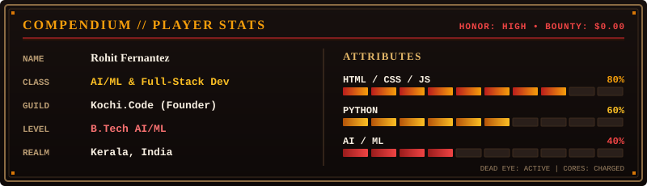

Self-taught AI/ML & Full-Stack builder from Kerala, India · Founder of **Kochi.Code** · [rfernz.biz](https://www.rfernz.biz)

### Quests

<b>Main Quest: Applied AI & ML Systems</b>

 

Exploring and building practical AI/ML applications, LLM fine-tuning workflows, and intelligent tools designed for real-world use.

<b>Side Quest: Portfolio</b>

 

My personal developer portfolio showcasing my projects, builds, and experiments at [rfernz.biz](https://www.rfernz.biz).

<b>Side Quest: Cooked? App</b>

 

An app project — **Cooked?** — currently in the works.

### Connect

| | |
|---|---|
| Hire me | [profrohitferns@gmail.com](mailto:profrohitferns@gmail.com) |
| Portfolio | [rfernz.biz](https://www.rfernz.biz) |
| LinkedIn | [linkedin.com/in/rohitfernantez](https://www.linkedin.com/in/rohitfernantez) |
