<div align="center">


**Self-taught builder from Kerala, India 🌴**
Studying AI/ML and running a digital agency on the side.

[](https://www.rfernz.biz)

</div>

---

## 🎮 Player Stats

```
┌──────────────────────────────────────────┐
│  NAME    : Rohit Fernantez               │
│  CLASS   : AI/ML & Full-Stack Dev        │
│  GUILD   : Kochi.Code (Founder)          │
│  LEVEL   : B.Tech AI/ML                  │
│  REALM   : Kerala, India                 │
├──────────────────────────────────────────┤
│  HTML/CSS/JS   ████████░░  80%           │
│  Python        ██████░░░░  60%           │
│  AI / ML       ████░░░░░░  40%           │
└──────────────────────────────────────────┘
```

---

## 🗺️ Quest Log (click to expand)

<details>
<summary><b>⚔️ Main Quest: Applied AI & ML Systems</b></summary>

<br>

Exploring and building practical AI/ML applications, LLM fine-tuning workflows, and intelligent tools designed for real-world use.

</details>

<details>
<summary><b>🕹️ Side Quest: Portfolio</b></summary>

<br>

My personal developer portfolio showcasing my projects, builds, and experiments at [rfernz.biz](https://www.rfernz.biz).

</details>

<details>
<summary><b>🍳 Side Quest: Cooked? App</b></summary>

<br>

An app project — **Cooked?** — currently in the works.

</details>

---

## 🧰 Inventory


---

## 🏙️ My GitHub City (rebuilt from my real activity every 12 hours)

<div align="center">

</div>

---

## 📊 Stats

<div align="center">


</div>

---

## 🎯 Choose your path

| If you want to... | Go here |
|---|---|
| 🏢 Hire me / Kochi.Code | [Send a message](mailto:your-email@example.com) |
| 🕹️ See my work | [Portfolio](https://www.rfernz.biz) |
| 🤝 Collaborate | [LinkedIn](https://linkedin.com/in/your-linkedin) |

---

<div align="center">


*GAME OVER? Never. Insert coin to continue.* 🪙

</div>
